<p align="center"></p>

<h1 align="center">GeeTree</h1>

<h3 align="center">The professional Git client,<br>rendered on the GPU.</h3>

<p align="center">Built for very large repositories. Millions of commits, open in a second.</p>

<p align="center">
  <a href="https://github.com/cmzy/geetree/releases/latest"></a>
  
  
</p>

<p align="center">
  <a href="#download"><b>Download</b></a> ·
  <a href="https://geetree.app/en/">Website</a> ·
  <a href="https://github.com/cmzy/geetree/releases">Releases</a> ·
  <a href="https://github.com/cmzy/geetree/issues">Feedback</a> ·
  <a href="README.zh-CN.md">简体中文</a>
</p>

<p align="center"><a href="https://geetree.app/en/">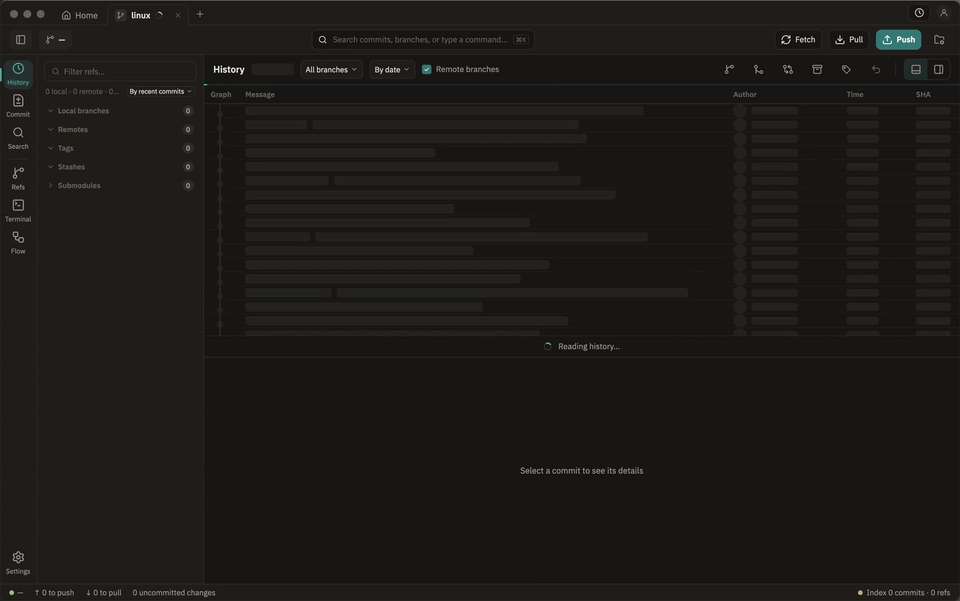</a></p>

<table align="center"><tr><td align="center"><h3>1.5M</h3><sub>commits, open in a second</sub></td><td align="center"><h3>0.5 s</h3><sub>to the first screen of commits</sub></td><td align="center"><h3>77 ms</h3><sub>to search 1.5 million commits</sub></td><td align="center"><h3>3</h3><sub>macOS · Windows · Linux</sub></td></tr></table>

## Built for very large repositories

**Millions of commits, open in a second.** 1.5 million commits on screen in half a second. Scroll, search and jump while the rest streams in.

<picture><source media="(prefers-color-scheme: dark)" srcset=".github/media/big-dark.gif">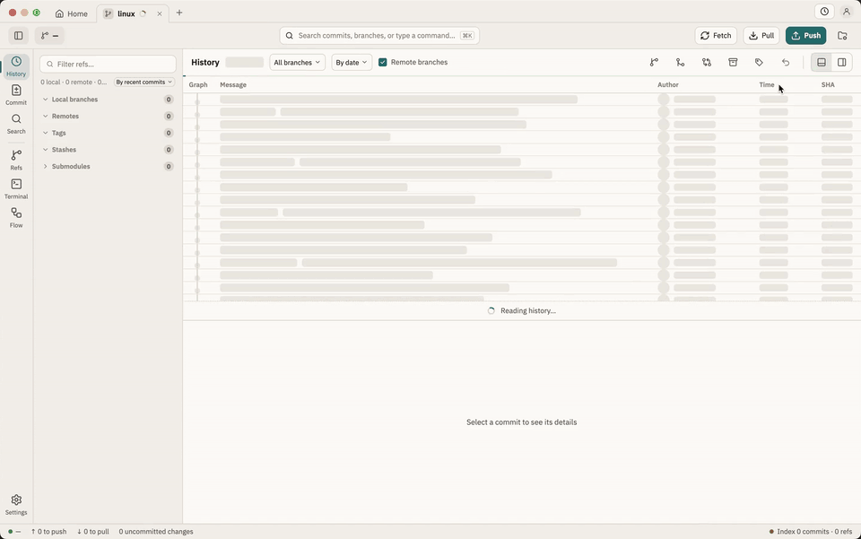</picture>

## Diff, commit and merge, on par with JetBrains

Side-by-side diffs, hunk staging, a three-way merge editor, blame, and compare anything with anything.

<picture><source media="(prefers-color-scheme: dark)" srcset=".github/media/commit-dark.gif">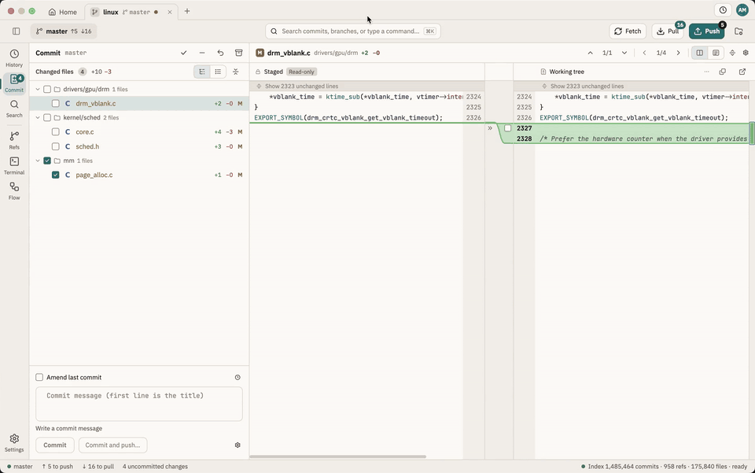</picture>

<table>
<tr><td width="50%" align="center" valign="top"><picture><source media="(prefers-color-scheme: dark)" srcset=".github/media/compare-dark.jpg">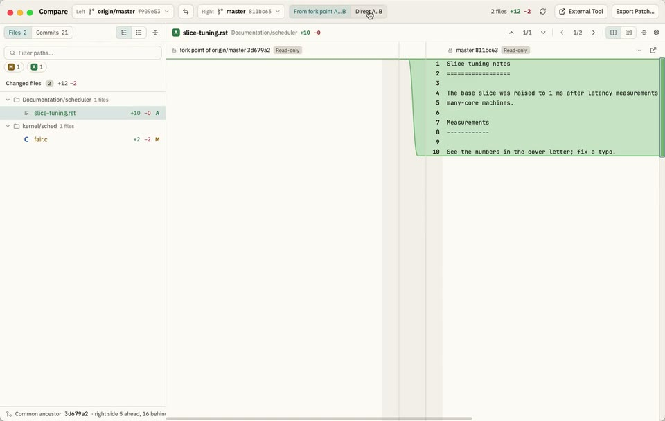</picture><br><sub>Compare</sub></td><td width="50%" align="center" valign="top"><picture><source media="(prefers-color-scheme: dark)" srcset=".github/media/merge-dark.jpg">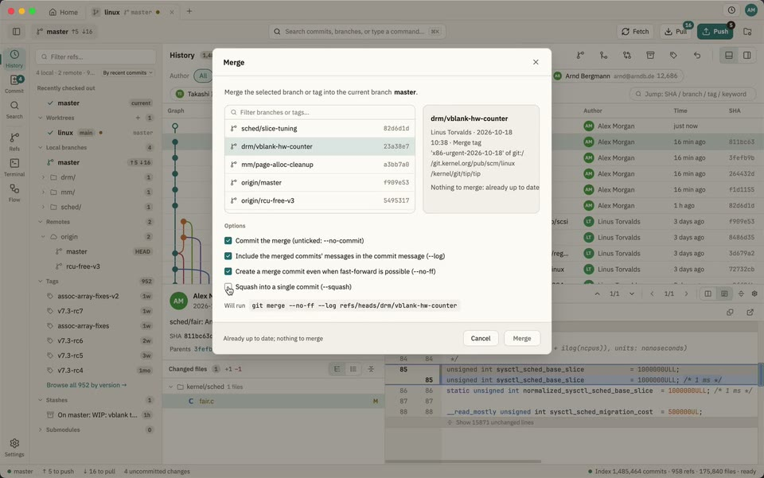</picture><br><sub>Merge</sub></td></tr>
</table>

## The same stack as Zed

Rust and GPUI. Every pixel drawn on the GPU. Silky smooth scrolling.

<picture><source media="(prefers-color-scheme: dark)" srcset=".github/media/scroll-dark.gif">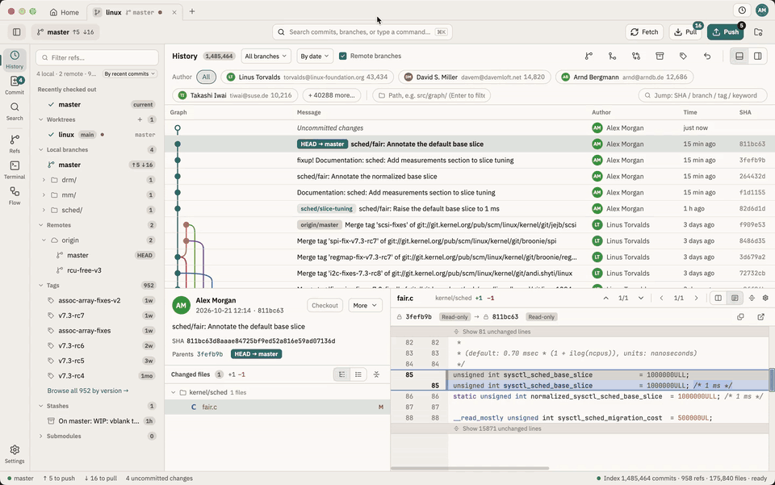</picture>

<table><tr><td><b>Rust</b></td><td>Native code. No browser, no garbage-collection pauses.</td></tr><tr><td><b>GPUI</b></td><td>The UI framework behind Zed. Rendered entirely on the GPU; a million rows, still smooth.</td></tr></table>

## Instant search, even on huge repositories

Search 1.5 million commits in milliseconds, by message, author, path, or the diff of every commit.

<picture><source media="(prefers-color-scheme: dark)" srcset=".github/media/search-dark.gif">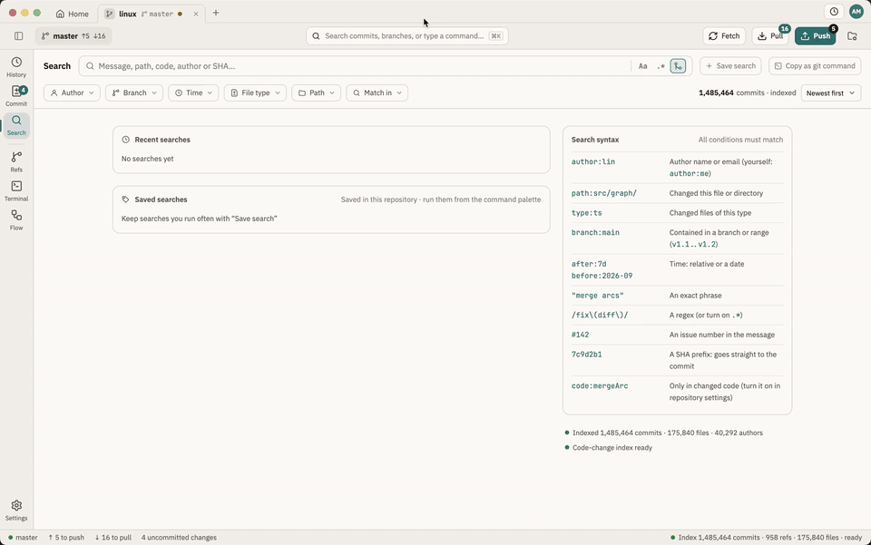</picture>

<table>
<tr><td width="100%" align="center" valign="top"><picture><source media="(prefers-color-scheme: dark)" srcset=".github/media/author-dark.jpg">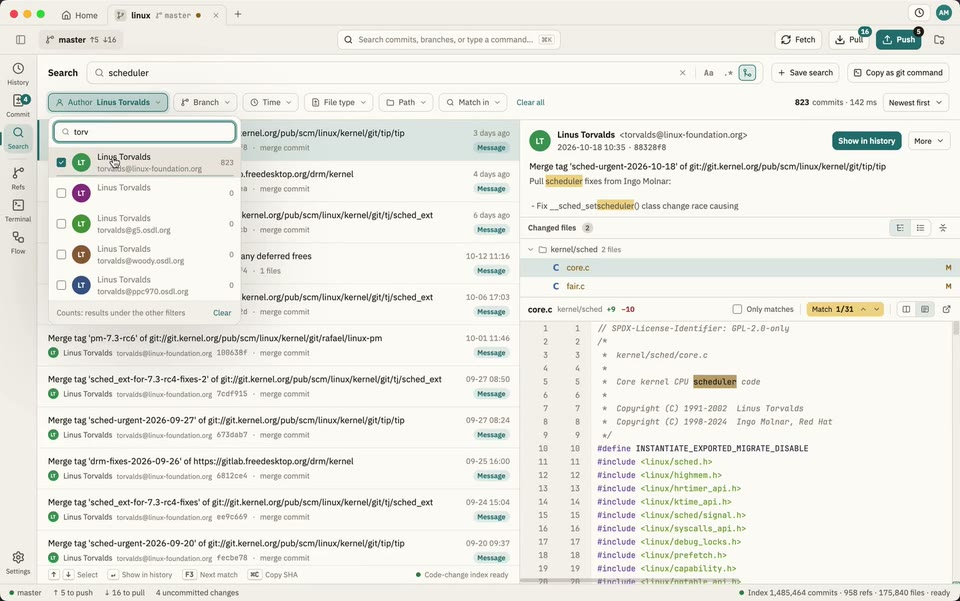</picture><br><sub>Filter by author</sub></td></tr>
</table>

## Every advanced workflow

Interactive rebase, worktrees, stashes, Git Flow, tabs, a built-in terminal and a ⌘K command palette.

<picture><source media="(prefers-color-scheme: dark)" srcset=".github/media/rebase-dark.gif">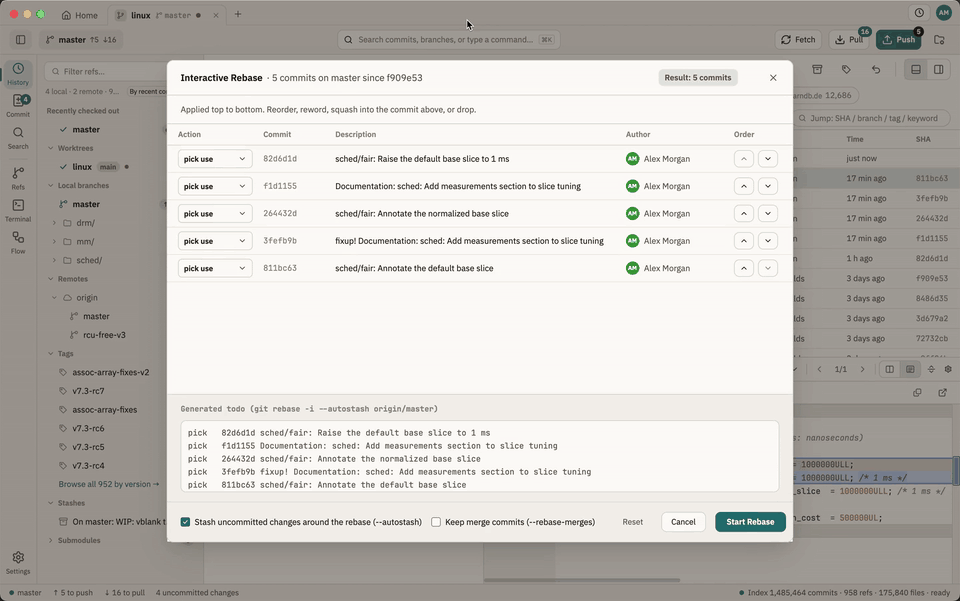</picture>

<table>
<tr><td width="33%" align="center" valign="top"><picture><source media="(prefers-color-scheme: dark)" srcset=".github/media/palette-dark.jpg">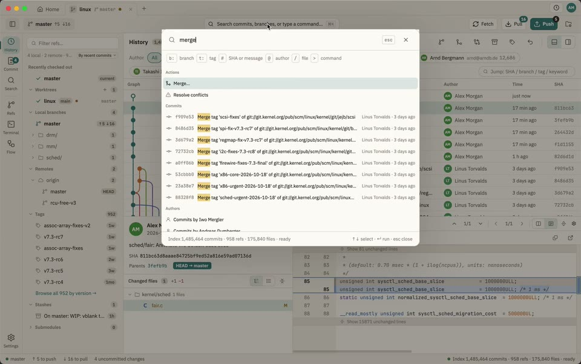</picture><br><sub>Command palette</sub></td><td width="33%" align="center" valign="top"><picture><source media="(prefers-color-scheme: dark)" srcset=".github/media/refs-dark.jpg">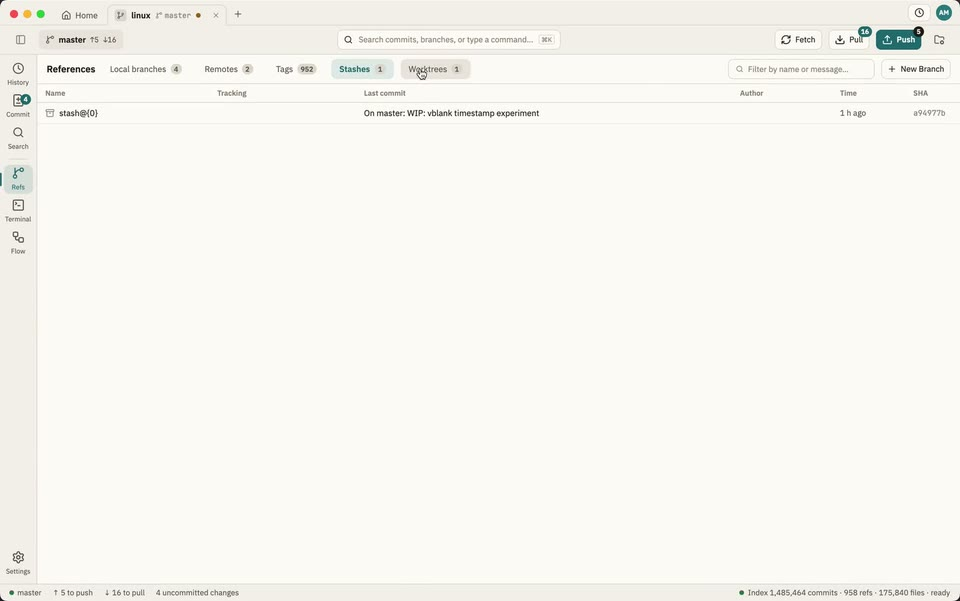</picture><br><sub>References</sub></td><td width="33%" align="center" valign="top"><picture><source media="(prefers-color-scheme: dark)" srcset=".github/media/home-dark.jpg">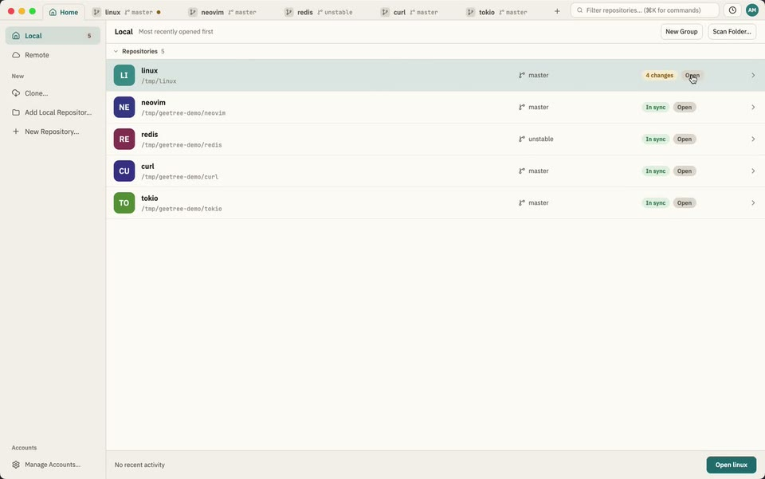</picture><br><sub>Home</sub></td></tr>
</table>

### More screens

<table>
<tr><td width="33%" align="center" valign="top"><picture><source media="(prefers-color-scheme: dark)" srcset=".github/media/push-dark.jpg">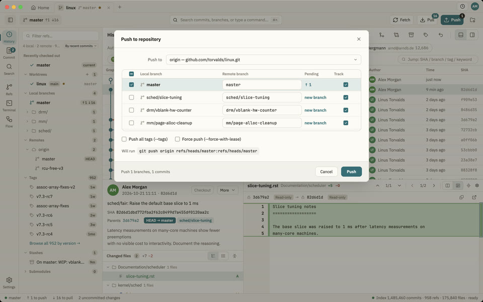</picture><br><sub>Push</sub></td><td width="33%" align="center" valign="top"><picture><source media="(prefers-color-scheme: dark)" srcset=".github/media/pull-dark.jpg">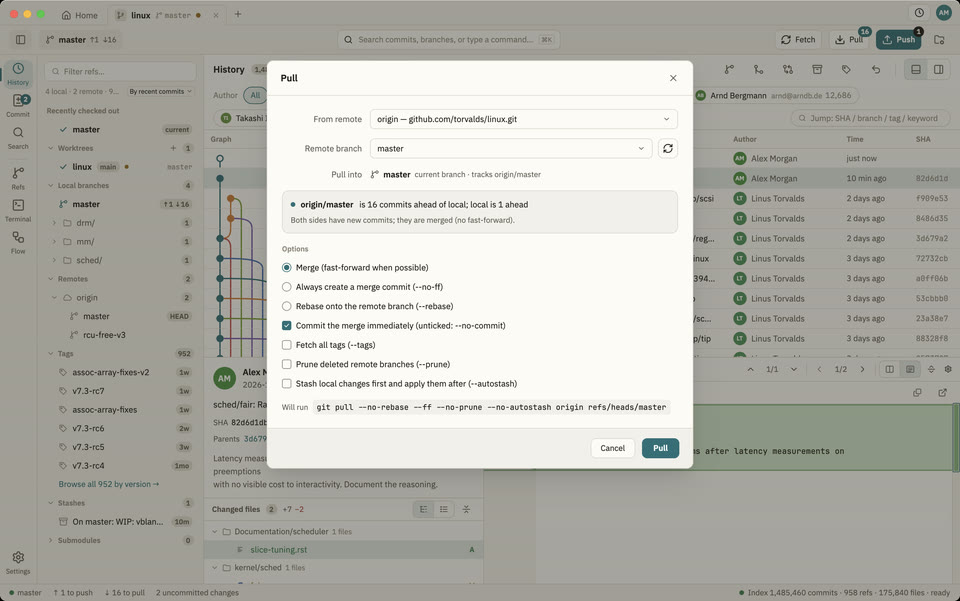</picture><br><sub>Pull</sub></td><td width="33%" align="center" valign="top"><picture><source media="(prefers-color-scheme: dark)" srcset=".github/media/worktrees-dark.jpg">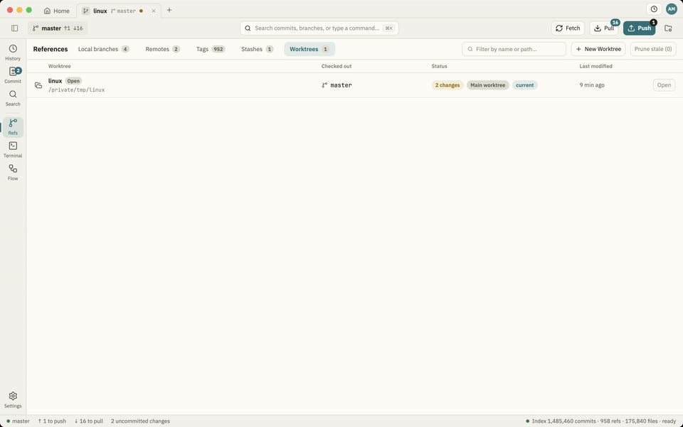</picture><br><sub>Worktrees</sub></td></tr>
<tr><td width="33%" align="center" valign="top"><picture><source media="(prefers-color-scheme: dark)" srcset=".github/media/terminal-dark.jpg">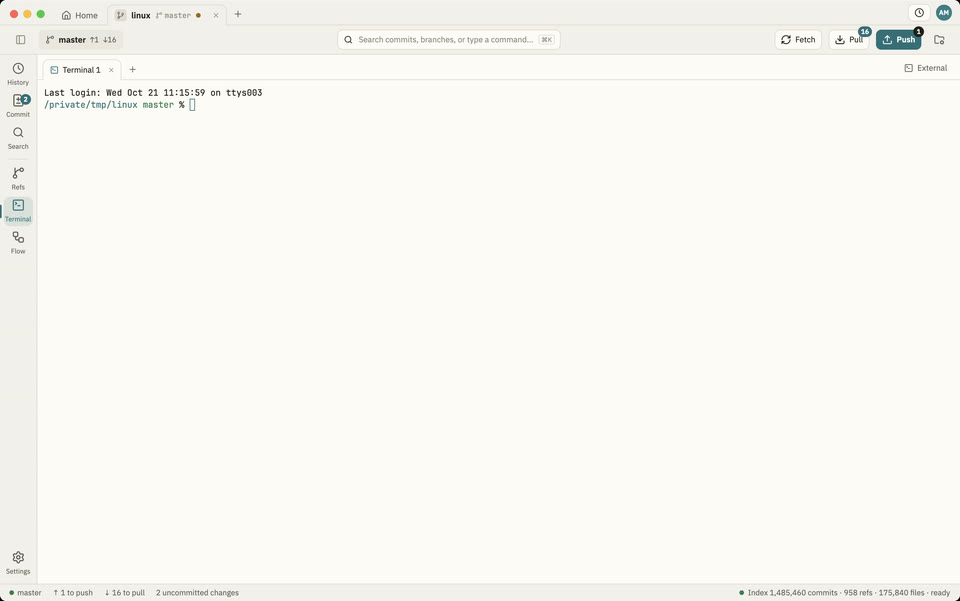</picture><br><sub>Terminal</sub></td><td width="33%" align="center" valign="top"><picture><source media="(prefers-color-scheme: dark)" srcset=".github/media/git-flow-dark.jpg">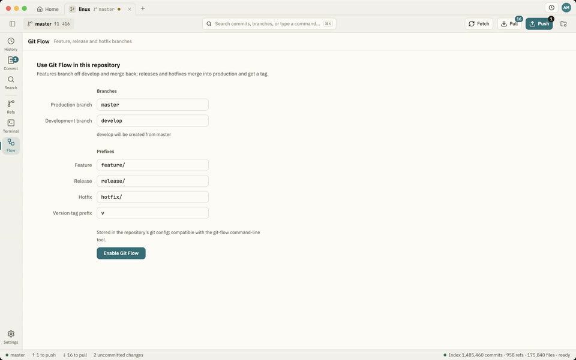</picture><br><sub>Git Flow</sub></td><td width="33%" align="center" valign="top"><picture><source media="(prefers-color-scheme: dark)" srcset=".github/media/preferences-dark.jpg">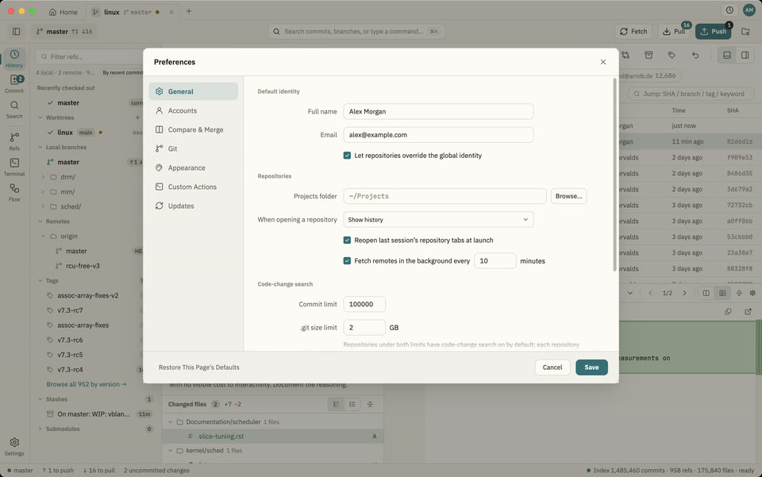</picture><br><sub>Preferences</sub></td></tr>
</table>

## Download

macOS, Windows and Linux. One app, every platform. Every platform needs git 2.30 or later.

| Platform | Download | Requirements |
|---|---|---|
| **macOS** | [Apple silicon](https://github.com/cmzy/geetree/releases/latest/download/GeeTree_aarch64.dmg) · [Intel](https://github.com/cmzy/geetree/releases/latest/download/GeeTree_x64.dmg) | macOS 12 or later |
| **Windows** | [Installer](https://github.com/cmzy/geetree/releases/latest/download/GeeTree_x64-setup.exe) (x64) | Windows 10 1809 or later |
| **Linux** | [AppImage](https://github.com/cmzy/geetree/releases/latest/download/GeeTree_x86_64.AppImage) · [.deb](https://github.com/cmzy/geetree/releases/latest/download/GeeTree_amd64.deb) (x64) | glibc 2.35 or later, Wayland or X11 |

**macOS**: install with [Homebrew](https://brew.sh) (it picks your chip), or open the `.dmg` and drag GeeTree into Applications. The app is signed and notarised by Apple.

```sh
brew install --cask cmzy/tap/geetree
```

**Windows**: run the installer. It installs for the current user, no admin rights needed. No git yet? `winget install Git.Git`

**Linux**: make the AppImage executable and run it, or install the `.deb` with your package manager (it pulls in git).

```sh
chmod +x GeeTree_x86_64.AppImage && ./GeeTree_x86_64.AppImage
# or
sudo apt install ./GeeTree_amd64.deb
```

Every release ships a `SHA256SUMS` file to verify the download against, and GeeTree updates itself when a new version is out. [All releases →](https://github.com/cmzy/geetree/releases)

## Privacy

GeeTree collects no usage data: no telemetry, no analytics. It goes online for three things — your own `git` talking to your own remotes, an update check at launch (at most once a day, carrying only the version and platform; Preferences &rarr; Update turns it off), and the API of a hosting account you signed in to yourself. Account tokens are kept in the system keychain, and crash reports stay on your machine. [What is sent, in full &rarr;](https://geetree.app/en/privacy/)

## Feedback

Found a bug or missing a feature? Open an [issue](https://github.com/cmzy/geetree/issues).

---

<p align="center"><b>Try it on your biggest repository.</b><br><a href="#download">Download</a> · <a href="https://geetree.app/en/">geetree.app</a></p>

<p align="center"><sub>This repository holds GeeTree's releases and issues; the source code is not published.</sub></p>
